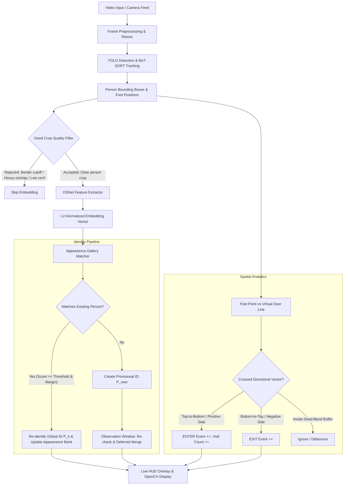

# 🚪 Real-Time Room Person Tracking & Re-Identification System

[](https://www.python.org/)
[](https://pytorch.org/)
[](https://github.com/ultralytics/ultralytics)
[](https://github.com/KaiyangZhou/deep-person-reid)
[](https://opencv.org/)

An intelligent computer vision system that tracks room occupancy, detects directional door entry/exit events, and maintains **persistent human identity across long occlusions and re-entries** using state-of-the-art deep person re-identification (OSNet).

---

## 📌 Key Capabilities

- **Robust Multi-Person Tracking**: Combines high-accuracy person detection with **BoT-SORT** tracking for smooth trajectory maintenance within the camera view.
- **Deep Person Re-Identification (OSNet)**: Uses an omni-scale feature extractor (`osnet_ain_x1_0`) to extract appearance embeddings ($L_2$-normalized vectors) invariant to posture, lighting, and viewing angles.
- **Persistent Long-Term Gallery**:
  - Maintains multi-view appearance banks (front, back, side angles) per identity.
  - Automatically prunes redundant feature vectors to maintain visual diversity.
- **Provisional IDs & Deferred Merging**:
  - Newly detected people are marked provisional (`P?` / `P<id>?`) during an initial observation window.
  - Tracks are automatically merged into existing global identities when confident re-identification occurs.
- **Coexistence Conflict Avoidance**:
  - Enforces a temporal co-occurrence invariant: two individuals who appeared on screen at the same time are never merged as the same person.
- **Virtual Door Boundary & Occupancy Analytics**:
  - Configurable 2D virtual door line with hysteresis dead-band filtering.
  - Accurate crossing detection calculated at the person's ground foot contact point.
  - Directional `ENTER` / `EXIT` detection, net room occupancy (`Inside = Entries - Exits`), and individual visit counting (`visit #2 (RE-ENTRY)`).
- **Interactive Live HUD**:
  - Real-time overlay showing inside count, entry/exit tallies, active gallery profiles, and processing FPS.

---

## 🏗️ System Architecture



---

## 📁 Repository Structure

```text
backend/
├── models/
│   ├── osnet_ain_x1_0_imagenet.pth   # Pre-trained OSNet Re-ID feature extractor
│   ├── osnet_x1_0_imagenet.pth       # Alternative OSNet weights
│   ├── yolo26l.pt                    # Large YOLO detection weights
│   └── yolo26n.pt                    # Nano YOLO detection weights (fast/lightweight)
├── testing/
│   ├── video1.mp4                    # Sample room entrance test footage
│   └── download.jpg                  # Test image
├── nootbooks/
│   └── person_detection.ipynb        # Exploratory notebook for detection & tuning
├── main.py                           # Main application pipeline
├── people_reid_tracker_v2.py         # Modular reference implementation
├── pyproject.toml                    # UV project configuration and dependencies
├── requirements.txt                  # Standard pip dependencies
├── uv.lock                           # Locked dependency resolution
└── README.md                         # Documentation
```

---

## 🚀 Quick Start Guide

### 1. Prerequisites

- Python 3.10, 3.11, 3.12, or 3.13
- Recommended: NVIDIA GPU with CUDA for real-time inference (CPU is supported as a fallback)

### 2. Environment Setup

#### Option A: Using `uv` (Recommended - Ultra Fast)

If you have [`uv`](https://github.com/astral-sh/uv) installed:

```bash
# Navigate to backend directory
cd backend

# Sync virtual environment directly from uv.lock
uv sync

# Run the tracking application
uv run python main.py
```

#### Option B: Using standard `pip` and virtual environment

```bash
# Create virtual environment
python -m venv .venv

# Activate virtual environment
# On Windows (PowerShell):
.venv\Scripts\Activate.ps1
# On Windows (CMD):
.venv\Scripts\activate.bat
# On Linux / macOS:
source .venv/bin/activate

# Upgrade pip
python -m pip install --upgrade pip

# Install dependencies
pip install -r requirements.txt
```

> **Note on PyTorch CUDA Support:**
> If you wish to enable GPU acceleration, install the CUDA-enabled wheel for PyTorch:
> ```bash
> pip install torch torchvision --index-url https://download.pytorch.org/whl/cu124
> ```

---

## ⚙️ Configuration Parameters

All operational settings can be tuned directly at the top of [`main.py`](file:///d:/demo%20project/Room%20tracking/backend/main.py):

### Source & Models

| Parameter | Default | Description |
| :--- | :--- | :--- |
| `VIDEO_PATH` | `"testing/video1.mp4"` | Video file path or `0` for live USB/webcam stream. |
| `MODEL_PATH` | `"./models/yolo26l.pt"` | YOLO weights path (`yolo26l.pt` for accuracy, `yolo26n.pt` for speed). |
| `TORCHREID_WEIGHTS` | `"./models/osnet_ain_x1_0_imagenet.pth"` | Pre-trained OSNet checkpoint for appearance vectors. |
| `TORCHREID_MODEL` | `"osnet_ain_x1_0"` | Architecture identifier corresponding to the weights. |
| `FRAME_WIDTH` | `960` | Normalized frame width (aspect ratio is preserved). |
| `DET_CONF` | `0.4` | Minimum detector confidence threshold for people. |

### Virtual Door & Counting

| Parameter | Default | Description |
| :--- | :--- | :--- |
| `DOOR_LINE` | `((0.0, 0.55), (1.0, 0.55))` | Coordinates as fractions of `(width, height)`. Format: `((x1, y1), (x2, y2))`. |
| `INSIDE_IS_POSITIVE_SIDE` | `True` | If `True`, crossing from negative side to positive side is counted as an `ENTER`. |
| `DOOR_BAND_PX` | `12` | Hysteresis dead-band buffer (in pixels) around the line to prevent jitter count. |

### Re-Identification & Gallery

| Parameter | Default | Description |
| :--- | :--- | :--- |
| `MATCH_THRESHOLD` | `0.70` | Minimum cosine similarity to recognize as the same person. |
| `MATCH_MARGIN` | `0.02` | Score difference required between best and 2nd best candidate. |
| `MIN_SAMPLES` | `3` | Quality crops needed before an identity is created or assigned. |
| `BANK_SIZE` | `12` | Maximum multi-angle appearance vectors stored per person. |
| `BANK_DIVERSITY` | `0.93` | Only adds new vectors to bank if similarity to existing ones is below this. |
| `RECHECK_S` | `8.0` | Duration (seconds) an ID remains provisional and eligible for merging. |
| `COEXIST_GRACE_S` | `1.0` | Grace window: persons coexisting after track creation cannot match. |
| `RETENTION_S` | `3600` | Gallery memory lifetime for unseen individuals (in video seconds). |

---

## 🏃 Running the Application

Execute the main tracking script:

```bash
python main.py
```

### Visual Interface & Controls

- **Bounding Boxes**:
  - Gray box with `P? (learning)`: Initial track gathering clean crops.
  - Colored box with `P1? t3`: Track `t3` provisionally assigned to Person `1`.
  - Colored box with `P1 t3`: Confirmed persistent global identity `P1`.
- **Feet Tracker**: A colored dot at the bottom center of the bounding box evaluating door boundary crossings.
- **Door Line**: Yellow boundary line across the room entryway.
- **Top HUD**: Shows current occupancy (`inside`), total entries (`in`), exits (`out`), unique people registered in gallery (`known people`), and real-time processing FPS.
- **Exit**: Press <kbd>q</kbd> while the OpenCV display window is focused to safely quit.

---

## 📊 Sample Console Output

```text
[Embedder] torchreid osnet_ain_x1_0 on cuda
[ID] track 1: NEW person P1 (provisional; best=-1.00, 2nd=-1.00)
[DOOR] P1 ENTER - visit #1
[ID] track 2: NEW person P2 (provisional; best=0.51, 2nd=0.48)
[DOOR] P2 ENTER - visit #1
[DOOR] P1 EXIT
...
[ID] track 4: RECOGNISED as P1 (score=0.82, 2nd=0.56)
[DOOR] P1 ENTER - visit #2 (RE-ENTRY)
```

---

## 🛠️ Tuning & Optimization Tips

1. **For Real-Time Performance on Laptops/CPUs**:
   - Change `MODEL_PATH` to `"./models/yolo26n.pt"` for 4-5x faster detection.
   - Reduce `FRAME_WIDTH` to `640` or `720`.
   - Increase `EMBED_EVERY` to `8` or `10` frames.
2. **Aligning the Virtual Door Line**:
   - Inspect camera angle and adjust `DOOR_LINE = ((x1, y1), (x2, y2))`.
   - Set `INSIDE_IS_POSITIVE_SIDE` based on whether the room interior is above or below the door line.
3. **Optimizing Re-ID Accuracy**:
   - If false merges occur between people wearing similar clothing, increase `MATCH_THRESHOLD` (e.g. `0.72` - `0.75`).
   - If returning people are mistakenly assigned new IDs, slightly lower `MATCH_THRESHOLD` (e.g. `0.65` - `0.68`) or increase `RECHECK_S`.

---

## 📜 License & Acknowledgments

- **Ultralytics YOLO**: [ultralytics/ultralytics](https://github.com/ultralytics/ultralytics)
- **Torchreid (Deep Person Re-ID)**: [KaiyangZhou/deep-person-reid](https://github.com/KaiyangZhou/deep-person-reid)
- **BoT-SORT**: Robust multi-object tracking system
